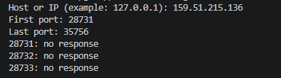

# Python Port Scanner

A simple TCP port scanner written in Python using the standard library.

## Requirements

- Python 3.10 or later


## Screenshot



## Usage

Run the script:

```bash
python port-scanner.py
